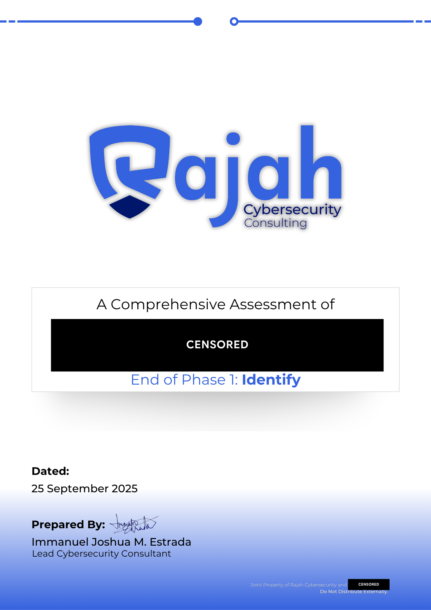
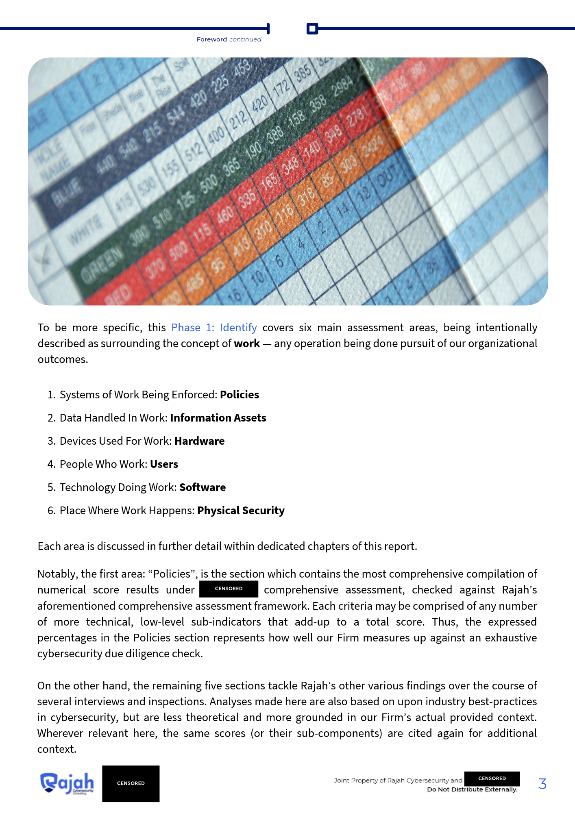
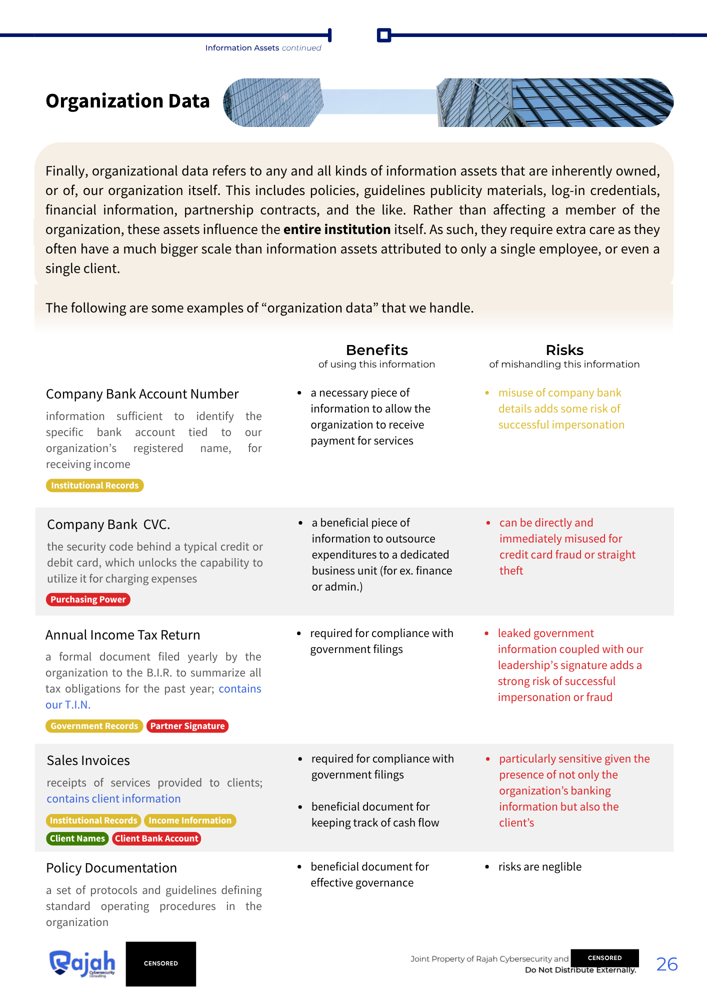
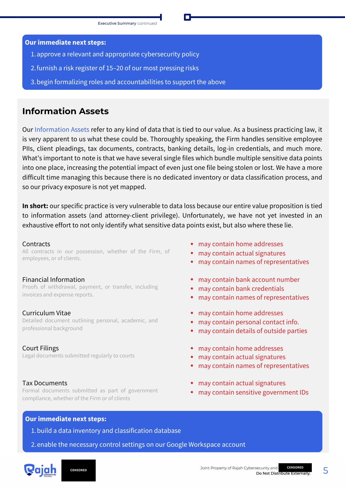
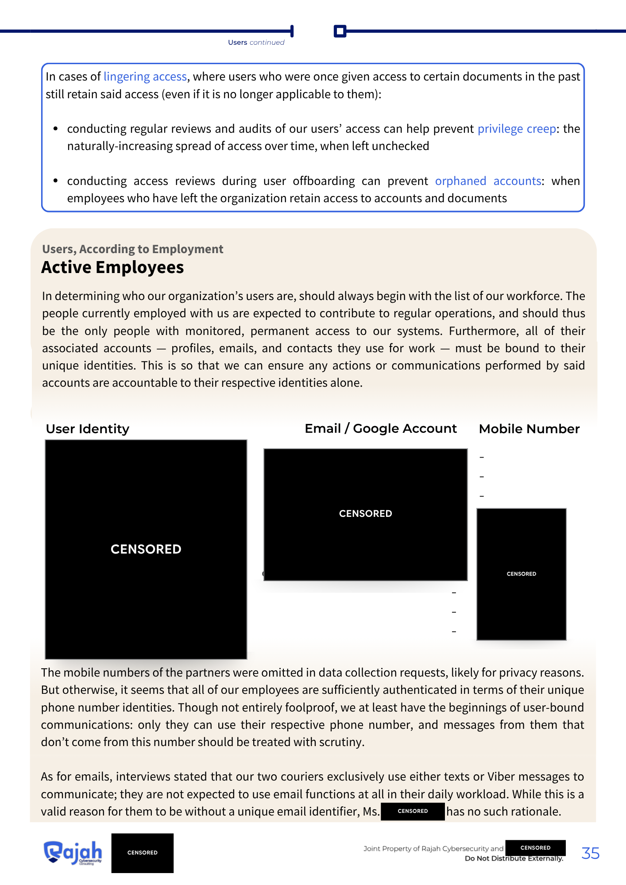
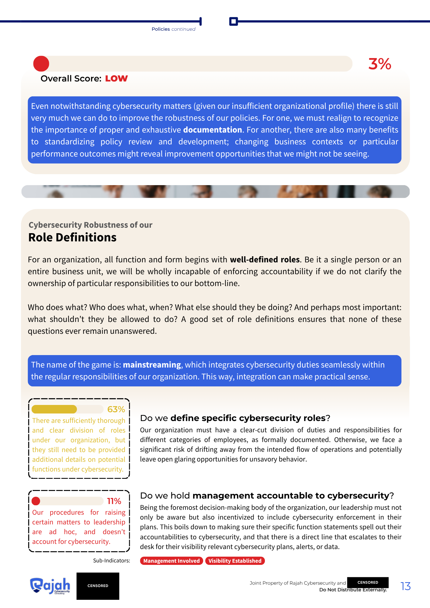
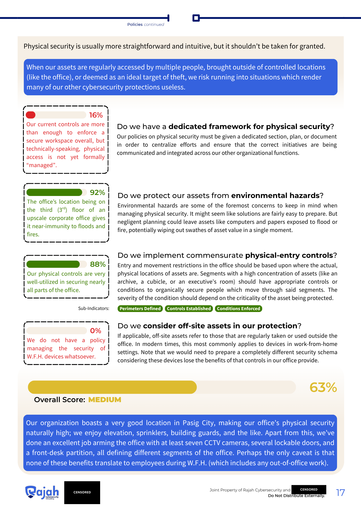

# VAPT Report Samples

**Disclaimer:** The samples in this repository are derived from authorized engagements. All client-identifying information, network details, and sensitive data have been redacted or replaced with placeholders to comply with NDAs. The methodology, structure, and technical depth remain authentic.

## 📄 Included Samples

Below are selected pages from a real report I authored during the **Identify** stage of an engagement. I have included these to demonstrate my methodology, technical writing style, and holistic approach to security assessments (covering digital, organizational, and physical domains).

### 1. Report Cover
*Demonstrates professional formatting, including the client name, VAPT stage, date, and consultant attribution (redacted).*

### 2. Foreword / Summary
*A quick breakdown of the report's contents and the scope of the current Identify stage.*

### 3. Organization Data
*Enumerates the various data asset types present in the organization and the corresponding level of risk involved with their potential loss (demonstrating risk prioritization).*

### 4. Information Assets
*An introductory narrative breaking down the various asset classes present in the client's business, and which organization data is stored in each.*

### 5. OSINT Stress Test
*Results of an OSINT stress test conducted on the client's staff, checking for the level of exposed information that can be collected by a complete outsider.*

### 6. Assessment Summary (Cybersecurity Roles)
*The beginning of the sub-chapter assessing the client's cybersecurity readiness according to their existing permanent IT roles and organizational structure.*

### 7. Assessment Summary (Physical Security)
*The beginning of the sub-chapter assessing the client's cybersecurity readiness according to the security of their physically-stored data assets.*

